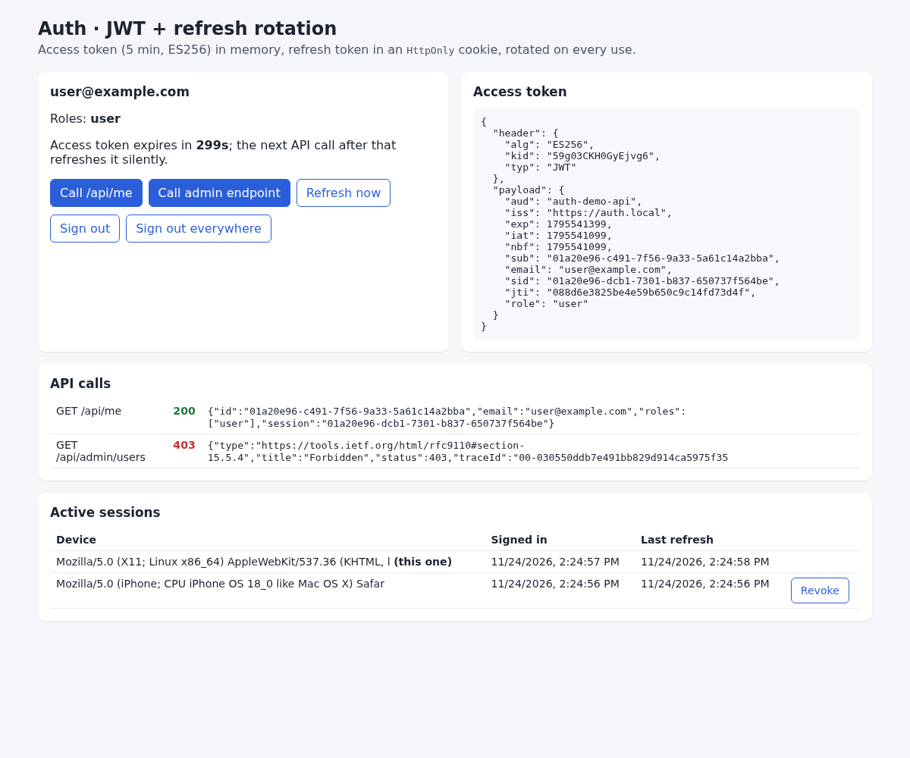
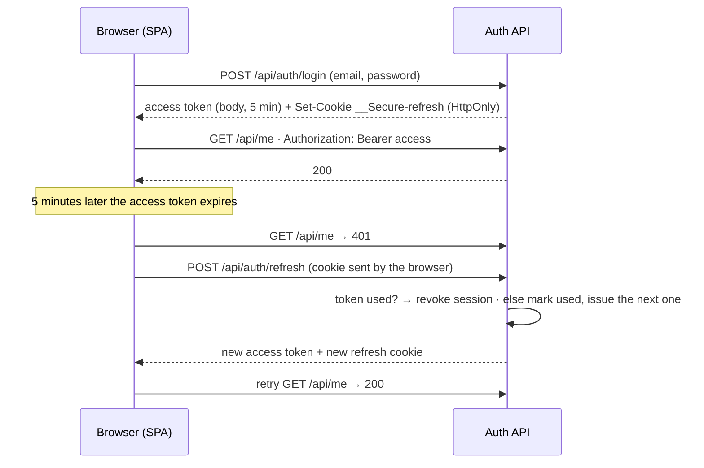

# Auth · JWT + Refresh Token Rotation

[](https://github.com/edybackend/auth-jwt-refresh/actions/workflows/ci.yml)
[Leia em português](README.pt-BR.md)

Authentication for a single-page app, done the way a security review would expect, on .NET 10 and React:
- **Access token:** short-lived (5 minutes), signed with **ES256**, public key published as **JWKS**, kept in the app's memory only.
- **Refresh token:** opaque, lives in an `HttpOnly` cookie, **rotated on every use**. **Reusing an old one revokes the whole session**, because it means someone else has a copy.
- **Passwords:** PBKDF2 with 600,000 iterations, lockout after failed attempts, and no way to tell which emails have accounts.



## Quick start

Requirements: Docker.

```bash
docker compose up --build
```

Open http://localhost:8080 and sign in as `user@example.com` or `admin@example.com`, password `correct-horse-battery`.
Reload the page: you stay signed in (silent refresh from the cookie). Sign in from another browser and revoke that session
from the first one. API reference: http://localhost:8080/scalar · [`requests.http`](requests.http).

Reuse detection, with `curl`:

```bash
curl -s -c jar -X POST localhost:8080/api/auth/login -H 'content-type: application/json' \
  -d '{"email":"user@example.com","password":"correct-horse-battery"}' > /dev/null
old=$(awk '/__Secure-refresh/ {print $7}' jar)
curl -s -b jar -c jar -X POST localhost:8080/api/auth/refresh > /dev/null           # the user refreshes: token rotated
curl -s -X POST localhost:8080/api/auth/refresh -H "Cookie: __Secure-refresh=$old"  # someone replays the old one
# {"status":401,"detail":"This session was revoked because a refresh token was used twice."}
curl -s -o /dev/null -w '%{http_code}\n' -b jar -X POST localhost:8080/api/auth/refresh   # 401: the real user is out too
```

<details>
<summary>Without Docker (.NET 10 SDK + Node 24)</summary>

```bash
cd web && npm ci && npm run build && cd ..     # builds the SPA into src/Auth.Api/wwwroot
dotnet run --project src/Auth.Api              # http://localhost:8080
```
</details>

## How it works



| Piece | Choice | Why |
|---|---|---|
| Access token | JWT, ES256, 5 min, `sub` `email` `role` `sid` `iss` `aud` | asymmetric: other services validate with the public key from `/.well-known/jwks.json` and cannot mint tokens |
| Where the SPA keeps it | a module variable | `localStorage` is readable by any injected script |
| Refresh token | 256 random bits, only its SHA-256 stored | a database leak does not leak usable tokens |
| Where it lives | `__Secure-refresh` cookie: `HttpOnly`, `Secure`, `SameSite=Strict`, `Path=/api/auth` | no script access (XSS), not sent cross-site (CSRF), only to the auth endpoints |
| Rotation | every refresh replaces it; the old one is marked used | a stolen token has a short useful life |
| Reuse detection | a used token comes back → its session (token family) is revoked | the server cannot tell attacker from user, so both must sign in again |
| Passwords | PBKDF2-SHA256, 600,000 iterations, per-user salt, parameters stored in the hash | the cost can be raised later without breaking old hashes |
| Login abuse | same answer and cost for unknown email and wrong password; 5 failures in 15 min lock the account; 20 attempts per minute per IP | no account enumeration, slow guessing |

## How it is tested

| Behavior | Test |
|---|---|
| Rotation: every refresh issues a new token | `Every_refresh_rotates_the_refresh_token` |
| Replaying a rotated token revokes the session for both holders | `Reusing_a_rotated_token_revokes_the_whole_session` |
| 5 simultaneous refreshes of one token: at most one wins | `Two_simultaneous_refreshes_of_one_token_cannot_both_succeed` |
| Tampered payload, token signed by another key, `alg: none`, wrong audience → 401 | `Forged_tokens_are_rejected`, `A_token_for_another_audience_is_rejected` |
| Expiry after 5 minutes, then a refresh works (clock moved by the test) | `A_token_expires_after_five_minutes_and_a_refresh_gives_a_working_one` |
| Lockout after 5 failures, even with the right password; failures outside the window do not add up | `LoginTests` |
| Cookie flags | `The_refresh_cookie_is_out_of_reach_of_scripts_and_other_sites` |
| Sessions: list, revoke one device, sign out everywhere, idle expiry | `RefreshTests` |
| The real container | CI job `container`: JWKS, login, 403, rotation, replay → 401 for both tokens |

A mutation proves the reuse tests are real: if a used token is treated as merely invalid, 2 tests fail.

## Tech stack

| Area | Choice |
|---|---|
| Back-end | .NET 10 minimal APIs, `JwtBearer` + `Microsoft.IdentityModel` (ES256), rate limiter, OpenAPI + Scalar |
| Persistence | SQLite + Dapper (users, sessions, refresh token hashes) |
| Front-end | React 19 + TypeScript + Vite, served by the API (same origin) |
| Quality | xUnit v3, WebApplicationFactory with an injectable clock, Roslyn analyzers (warnings as errors), oxlint |
| Delivery | three-stage image (Node → SDK → non-root runtime), Docker Compose, GitHub Actions |

## Design decisions

- **Same origin for SPA and API.** No CORS, and `SameSite=Strict` cookies just work. This is the "backend serves the SPA" pattern; a BFF would go further and keep even the access token on the server.
- **Short access tokens instead of revocable ones.** Validating a JWT needs no database, which is its point. Revocation happens at the next refresh, within 5 minutes.
- **Reuse detection instead of a grace period.** Some systems accept a reused token for a few seconds to tolerate races. Here the SPA serializes refreshes instead (single-flight), and the server stays strict.
- **ES256, not HS256.** With a shared secret, every service that validates tokens could also forge them.
- **Lockout per account plus rate limit per IP.** Each one covers what the other misses: a single account guessed from many IPs, and many accounts guessed from one IP.

## Known trade-offs

- **Lockout can be used to annoy a user** (lock someone else's account on purpose). Production systems add CAPTCHA or progressive delays instead of a hard lock.
- **The `423` reveals that an account exists** once it is locked. That keeps the demo clear; a stricter system would answer `401` and notify the owner.
- **One signing key.** The JWKS format supports several keys for rotation (publish the new one, start signing with it, retire the old one), which is not implemented here.
- **No email verification, password reset or MFA.** They are outside the scope of this repository.

## Working with an AI agent

Authentication code fails quietly: one `ValidateLifetime = false` and everything still "works". When I use an AI agent here, hooks in [`.claude/`](.claude) refuse weakened token validation, changes to the cookie flags, passwords or tokens in logs, and tokens in web storage. The security rules are in [`CLAUDE.md`](CLAUDE.md).

## License

[MIT](LICENSE)
