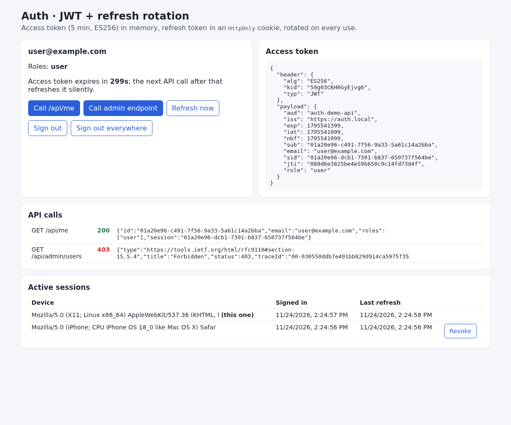
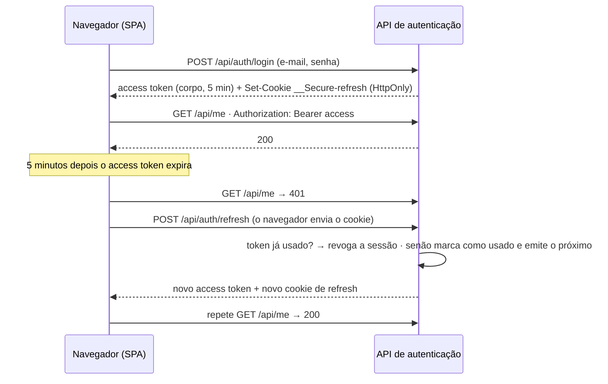

# Auth · JWT + rotação de refresh token

[](https://github.com/edybackend/auth-jwt-refresh/actions/workflows/ci.yml)
[Read in English](README.md)

Autenticação para uma SPA feita como uma revisão de segurança esperaria, em .NET 10 e React:
- **Access token:** curto (5 minutos), assinado com **ES256**, chave pública publicada como **JWKS**, guardado só na memória do app.
- **Refresh token:** opaco, fica num cookie `HttpOnly` e é **trocado a cada uso**. **Reusar um antigo derruba a sessão inteira**, porque significa que outra pessoa tem uma cópia.
- **Senhas:** PBKDF2 com 600 mil iterações, bloqueio após tentativas erradas, e nenhum jeito de descobrir quais e-mails têm conta.



## Como rodar

Requisito: Docker.

```bash
docker compose up --build
```

Abra http://localhost:8080 e entre com `user@example.com` ou `admin@example.com`, senha `correct-horse-battery`.
Recarregue a página: você continua logado (refresh silencioso pelo cookie). Entre por outro navegador e revogue essa
sessão a partir do primeiro. Referência da API: http://localhost:8080/scalar · [`requests.http`](requests.http).

Detecção de reuso, com `curl`:

```bash
curl -s -c jar -X POST localhost:8080/api/auth/login -H 'content-type: application/json' \
  -d '{"email":"user@example.com","password":"correct-horse-battery"}' > /dev/null
old=$(awk '/__Secure-refresh/ {print $7}' jar)
curl -s -b jar -c jar -X POST localhost:8080/api/auth/refresh > /dev/null           # o usuário renova: token trocado
curl -s -X POST localhost:8080/api/auth/refresh -H "Cookie: __Secure-refresh=$old"  # alguém reapresenta o antigo
# {"status":401,"detail":"This session was revoked because a refresh token was used twice."}
curl -s -o /dev/null -w '%{http_code}\n' -b jar -X POST localhost:8080/api/auth/refresh   # 401: o usuário real também saiu
```

<details>
<summary>Sem Docker (.NET 10 SDK + Node 24)</summary>

```bash
cd web && npm ci && npm run build && cd ..     # compila a SPA em src/Auth.Api/wwwroot
dotnet run --project src/Auth.Api              # http://localhost:8080
```
</details>

## Como funciona



| Peça | Escolha | Por quê |
|---|---|---|
| Access token | JWT, ES256, 5 min, `sub` `email` `role` `sid` `iss` `aud` | assimétrico: outros serviços validam com a chave pública de `/.well-known/jwks.json` e não conseguem emitir tokens |
| Onde a SPA guarda | uma variável de módulo | o `localStorage` pode ser lido por qualquer script injetado |
| Refresh token | 256 bits aleatórios; só o SHA-256 é gravado | vazar o banco não vaza tokens utilizáveis |
| Onde ele fica | cookie `__Secure-refresh`: `HttpOnly`, `Secure`, `SameSite=Strict`, `Path=/api/auth` | sem acesso por script (XSS), não vai em requisição de outro site (CSRF), só chega aos endpoints de auth |
| Rotação | cada refresh troca o token; o antigo fica marcado como usado | um token roubado tem vida útil curta |
| Detecção de reuso | um token usado volta → a sessão dele (família de tokens) é revogada | o servidor não sabe quem é o atacante e quem é o usuário, então os dois precisam entrar de novo |
| Senhas | PBKDF2-SHA256, 600 mil iterações, salt por usuário, parâmetros gravados no hash | o custo pode subir depois sem quebrar os hashes antigos |
| Abuso de login | mesma resposta e mesmo custo para e-mail inexistente e senha errada; 5 falhas em 15 min bloqueiam a conta; 20 tentativas por minuto por IP | sem enumeração de contas, adivinhação lenta |

## Como é testado

| Comportamento | Teste |
|---|---|
| Rotação: cada refresh emite um token novo | `Every_refresh_rotates_the_refresh_token` |
| Reapresentar um token trocado revoga a sessão para os dois portadores | `Reusing_a_rotated_token_revokes_the_whole_session` |
| 5 refreshes simultâneos do mesmo token: no máximo um vence | `Two_simultaneous_refreshes_of_one_token_cannot_both_succeed` |
| Payload adulterado, token assinado por outra chave, `alg: none`, audiência errada → 401 | `Forged_tokens_are_rejected`, `A_token_for_another_audience_is_rejected` |
| Expira em 5 minutos e o refresh funciona (relógio movido pelo teste) | `A_token_expires_after_five_minutes_and_a_refresh_gives_a_working_one` |
| Bloqueio após 5 falhas, mesmo com a senha certa; falhas fora da janela não somam | `LoginTests` |
| Atributos do cookie | `The_refresh_cookie_is_out_of_reach_of_scripts_and_other_sites` |
| Sessões: listar, revogar um dispositivo, sair de todos, expiração por inatividade | `RefreshTests` |
| O contêiner real | job `container` do CI: JWKS, login, 403, rotação, reuso → 401 para os dois tokens |

Uma mutação prova que os testes de reuso são reais: se o token usado for tratado só como inválido, 2 testes falham.

## Tecnologias

| Área | Escolha |
|---|---|
| Back-end | minimal APIs .NET 10, `JwtBearer` + `Microsoft.IdentityModel` (ES256), rate limiter, OpenAPI + Scalar |
| Persistência | SQLite + Dapper (usuários, sessões, hashes dos refresh tokens) |
| Front-end | React 19 + TypeScript + Vite, servido pela API (mesma origem) |
| Qualidade | xUnit v3, WebApplicationFactory com relógio injetável, analisadores Roslyn (avisos viram erro), oxlint |
| Entrega | imagem em 3 estágios (Node → SDK → runtime sem root), Docker Compose, GitHub Actions |

## Decisões de design

- **Mesma origem para SPA e API.** Sem CORS, e cookies `SameSite=Strict` funcionam naturalmente. É o padrão "o back-end serve a SPA"; um BFF iria além e manteria até o access token no servidor.
- **Access token curto em vez de revogável.** Validar um JWT não precisa de banco, e essa é a vantagem dele. A revogação acontece no próximo refresh, em até 5 minutos.
- **Detecção de reuso em vez de período de tolerância.** Alguns sistemas aceitam um token reusado por alguns segundos para tolerar corridas. Aqui a SPA serializa os refreshes (single-flight), e o servidor continua rigoroso.
- **ES256, não HS256.** Com segredo compartilhado, todo serviço que valida tokens também conseguiria forjá-los.
- **Bloqueio por conta + limite por IP.** Um cobre o que o outro deixa passar: uma conta atacada de muitos IPs e muitas contas atacadas de um IP.

## Trade-offs conhecidos

- **O bloqueio pode ser usado para incomodar alguém** (travar a conta de outra pessoa de propósito). Sistemas de produção usam CAPTCHA ou atrasos progressivos em vez de bloqueio total.
- **O `423` revela que a conta existe**, uma vez que ela está bloqueada. Isso deixa a demo clara; um sistema mais rígido responderia `401` e avisaria o dono.
- **Uma chave de assinatura só.** O formato JWKS suporta várias chaves para rotação (publicar a nova, passar a assinar com ela, aposentar a antiga), o que não está implementado aqui.
- **Sem confirmação de e-mail, troca de senha ou MFA.** Estão fora do escopo deste repositório.

## Trabalhando com um agente de IA

Código de autenticação falha em silêncio: um `ValidateLifetime = false` e tudo continua "funcionando". Quando uso um agente de IA aqui, hooks em [`.claude/`](.claude) recusam afrouxar a validação do token, mexer nos atributos do cookie, senhas ou tokens em log e tokens em web storage. As regras de segurança estão no [`CLAUDE.md`](CLAUDE.md).

## Licença

[MIT](LICENSE)
